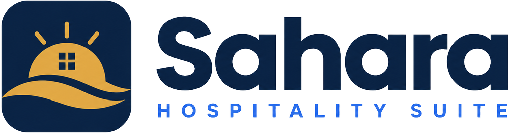
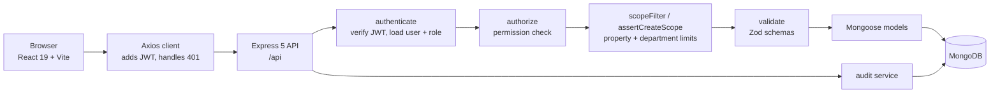
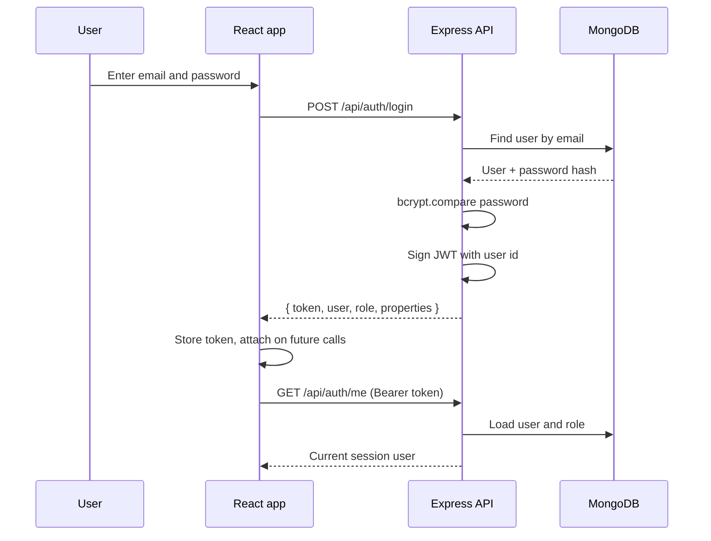
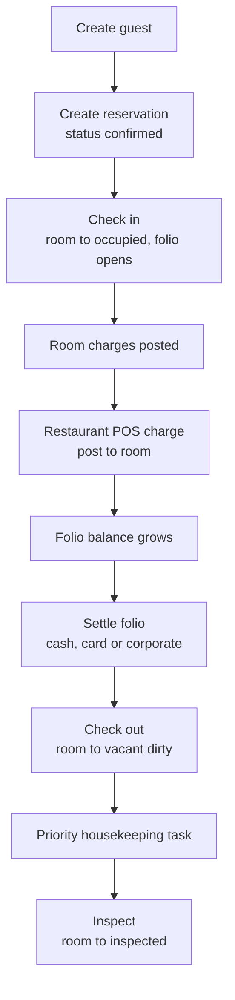
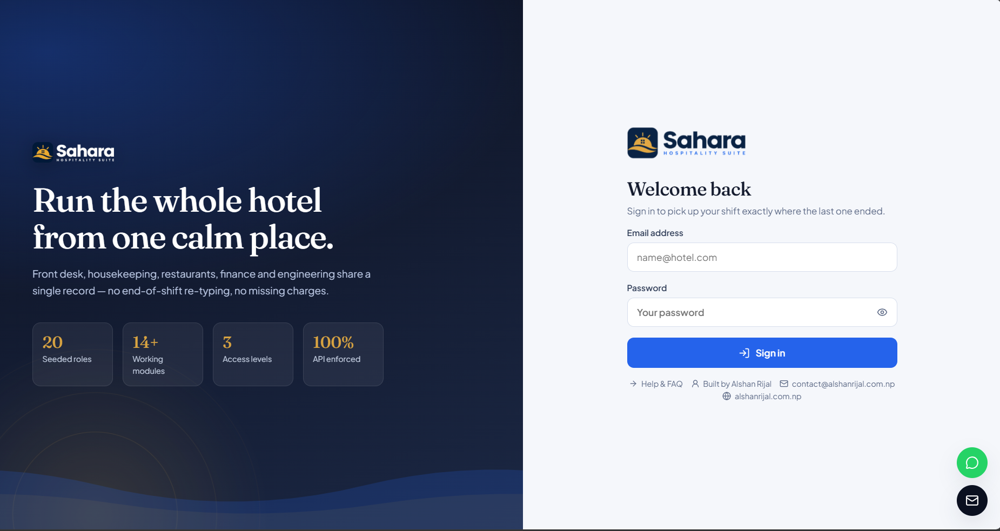
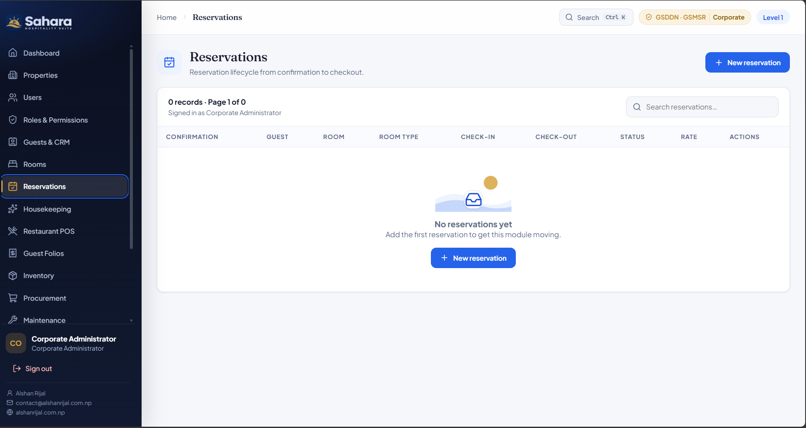
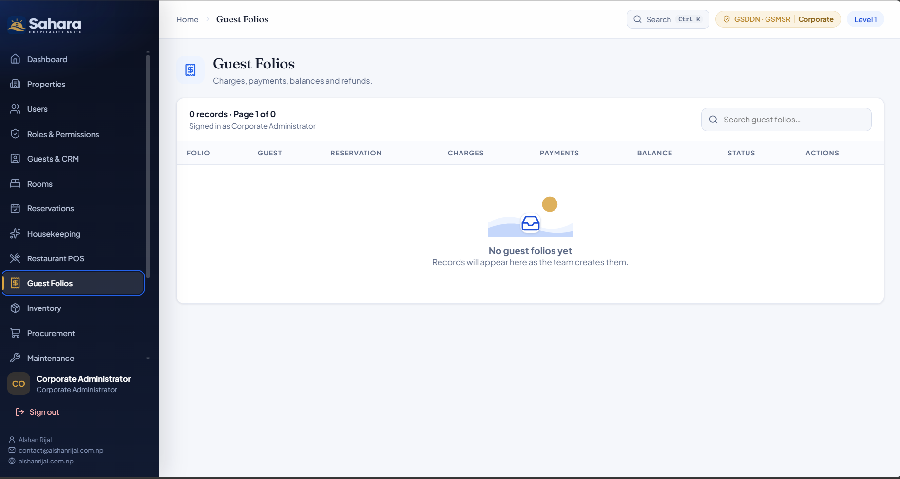
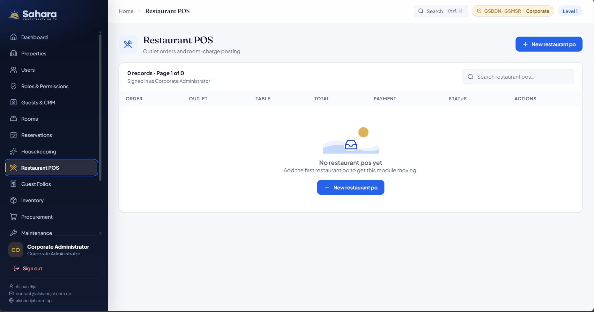

<div align="center">

<picture>
  <source media="(prefers-color-scheme: dark)" srcset="https://raw.githubusercontent.com/alshan-rijal/Sahara-Hospitality-Suite/main/apps/web/public/brand/sahara-logo-white.png" />
  
</picture>

### Run every hotel in your group from one calm, clear place.

Front office, housekeeping, restaurants, finance, procurement, maintenance, HR, security and audit — connected end to end.



[](https://react.dev)
[](https://www.typescriptlang.org)
[](https://vite.dev)
[](https://nodejs.org)
[](https://expressjs.com)
[](https://www.mongodb.com)
[](https://www.docker.com)
[](LICENSE)

[Product](#what-is-sahara-hospitality-suite) · [Features](#key-features) · [Access model](#roles-and-access-model) [Architecture](#architecture-and-data-flow) · [Get started](#getting-started) · [API](#api-overview) · [Author](#author)

</div>

---

## What is Sahara Hospitality Suite?

Sahara Hospitality Suite is a multi-property hotel operations platform. It is built for groups that run more than one hotel and need every property to follow the same process without losing local control.

**Built for**

- **Hotel groups and management companies** that want one system across all properties.
- **General managers** who need a live picture of arrivals, departures, revenue and exceptions.
- **Department heads** in housekeeping, food and beverage, engineering, procurement, HR and security.
- **Front desk and finance teams** who move a guest from booking to settled folio every day.

**Problems it solves**

- **Fragmented tools.** One place instead of spreadsheets, chat and several disconnected apps.
- **No visibility across sites.** Corporate users see the whole group; property users see only their hotel; department users see only their team.
- **Guest-to-cash breaks.** Reservations, check-in, room charges, folios, settlement and checkout are one connected flow.
- **Uncontrolled spend.** Purchase requisitions go through a real approval step and land in the audit log.
- **Weak accountability.** Sensitive actions are recorded with the user, time and IP address.

---

## Key features

| Department | What it does |
| --- | --- |
| **Front office** | Guest profiles with loyalty tiers, VIP flags and preferences. Reservations with availability checks, room assignment, check-in and checkout. A folio opens on check-in and carries every charge to settlement. |
| **Housekeeping** | Cleaning, turndown, minibar and inspection tasks with priority and due time. Assignment to staff, then start, complete and inspect. |
| **Food and beverage** | Restaurant POS orders by outlet and table. Post a meal or minibar charge straight to an in-house guest's folio. |
| **Finance** | Guest folios with charges, payments, balances and refunds. Settlement by cash, card, bank transfer, wallet or corporate account. |
| **Procurement** | Purchase requisitions with line items and estimated cost. Manager approval or rejection with a recorded note and timestamp. |
| **Maintenance** | Engineering work orders with priority, asset, parts and labour cost. Technician assignment and a full status lifecycle through to closed. |
| **Inventory** | Department stock with reorder levels, unit cost and expiry tracking. |
| **HR** | Employee records, department, designation, shift and salary. |
| **Sales and events** | Banquet and event pipeline from lead to confirmed, with package value and advances. |
| **Security** | Incident reporting by category and severity, with investigation and resolution. |
| **Audit and control** | An immutable log of sensitive activity: who did what, to which record, from which IP. |

---

## Roles and access model

Security lives in the API, not in the buttons. Hiding a control in the browser is a convenience; every request is checked again on the server.

There are three access levels:

| Level | Name | What it can reach |
| --- | --- | --- |
| 1 | Corporate | Group-wide records, or the regional properties assigned to the user |
| 2 | Property management | One or more assigned hotels |
| 3 | Department operations | An assigned property plus an assigned department |

Every access decision combines the same four pieces:

- **Permission** — a granular right such as `reservations.checkin` or `folios.settle`.
- **Scope** — `corporate`, `property`, `department` or `self` decides how far a query reaches.
- **Property assignment** — `propertyIds` on the user limits which hotels they see and create for.
- **Department assignment** — `departmentIds` narrows a department-scope role to its own team.
- **Workflow state** — some actions are only valid in the right state, such as checkout after check-in.

The server applies this in two steps: a permission check (`authorize(...)`) and a scope filter (`scopeFilter` / `assertCreateScope`) that rewrites every query and every create to the caller's allowed properties and departments.

### Seeded roles

Every seeded role uses the same password. The email is the role code plus `@sahara.test`.

| Role | Code | Level | Scope | Department |
| --- | --- | --- | --- | --- |
| Corporate Administrator | `corporate_admin` | 1 | corporate | — |
| Group Owner | `group_owner` | 1 | corporate | — |
| Corporate Finance Director | `corporate_finance` | 1 | corporate | — |
| Regional Manager | `regional_manager` | 1 | property | — |
| General Manager | `general_manager` | 2 | property | — |
| Front Office Manager | `front_office_manager` | 2 | property | front_office |
| Housekeeping Manager | `housekeeping_manager` | 2 | department | housekeeping |
| Food & Beverage Manager | `fnb_manager` | 2 | department | food_beverage |
| Finance Manager | `finance_manager` | 2 | property | finance |
| Purchase Manager | `purchase_manager` | 2 | property | procurement |
| Engineering Manager | `engineering_manager` | 2 | department | engineering |
| HR Manager | `hr_manager` | 2 | property | hr |
| Sales & Banquet Manager | `sales_manager` | 2 | property | sales |
| Security Manager | `security_manager` | 2 | department | security |
| Receptionist | `receptionist` | 3 | property | front_office |
| Night Auditor | `night_auditor` | 3 | property | front_office |
| Room Attendant | `room_attendant` | 3 | department | housekeeping |
| Waiter / POS Operator | `waiter` | 3 | department | food_beverage |
| Storekeeper | `storekeeper` | 3 | department | stores |
| Maintenance Technician | `technician` | 3 | department | engineering |

Passwords are hashed with bcrypt. Sessions use a signed JWT.

---

## Tech stack

| Layer | Choice | Why |
| --- | --- | --- |
| Frontend | React 19 + Vite | Fast dev server, modern component model, small production bundle |
| Routing | React Router 7 | Client routing with protected routes |
| Data fetching | Axios | Interceptors add the auth token and handle 401s in one place |
| Icons | Lucide React | One consistent, accessible icon system |
| Typography | Fraunces + Plus Jakarta Sans | A hospitality display face over a tuned product UI face |
| Backend | Express 5 + TypeScript | Familiar HTTP framework with end-to-end type safety |
| Database | MongoDB + Mongoose | Flexible documents suit varied hotel records; schema hooks enforce rules |
| Auth | JWT + bcrypt | Stateless sessions and hashed passwords |
| Validation | Zod | Request bodies are validated at the trust boundary |
| Security | Helmet + CORS | Sensible headers and a locked-down origin allow-list |
| Logging | Morgan | Request logs in dev and combined logs in production |
| Tooling | npm workspaces + tsx + Vitest | One install, direct TypeScript execution, unit tests |
| Container | Docker Compose | One command for MongoDB, the API and the web build |

---

## Architecture and data flow

### System architecture



### Login with JWT



### Reservation to checkout lifecycle



---

## Folder structure

```text
sahara-hospitality-suite/
├── apps/
│   ├── server/                 Express 5 + Mongoose API
│   │   └── src/
│   │       ├── config/         Environment parsing and database connection
│   │       ├── constants/      The permission list and scope types
│   │       ├── middleware/     Auth, permission, scope, validation, errors
│   │       ├── models/         Mongoose schemas for every entity
│   │       ├── routes/         Route groups, generic CRUD factory, workflows
│   │       ├── services/       Audit logging and data-scope rules
│   │       ├── utils/          ApiError, async handler, pagination helper
│   │       ├── app.ts          Express app wiring and route mounting
│   │       ├── index.ts        Server bootstrap
│   │       └── seed.ts         Drops and reseeds demo data
│   └── web/                    React 19 + Vite single-page app
│       ├── public/brand/       Official logo artwork and the app mark
│       ├── scripts/            Brand asset generation script
│       └── src/
│           ├── components/     Layout, modals, protected route
│           ├── context/        Auth context and session handling
│           ├── lib/            Axios client, icons, module configuration
│           ├── pages/          Login, dashboard, module and 404 pages
│           └── styles.css      Design tokens, typography and motion
├── docs/
│   ├── brand/                  Animated README banner and footer
│   ├── API_ENDPOINTS.md        Every route
│   ├── ARCHITECTURE.md         Request flow and design
│   └── RBAC.md                 Roles, permissions and scopes
├── docker-compose.yml          MongoDB, API and web services
└── package.json                Workspace scripts
```

---

## Getting started

### 1. Prerequisites

- Node.js 20.19 or newer
- npm 10 or newer
- MongoDB 7/8 running locally, Docker Desktop, or a MongoDB Atlas connection string

### 2. Install

```bash
npm install
```

### 3. Configure environment

```powershell
# Windows PowerShell
Copy-Item apps/server/.env.example apps/server/.env
Copy-Item apps/web/.env.example apps/web/.env
```

```bash
# macOS / Linux
cp apps/server/.env.example apps/server/.env
cp apps/web/.env.example apps/web/.env
```

**API variables** (`apps/server/.env`)

| Variable | Example | Purpose |
| --- | --- | --- |
| `MONGODB_URI` | `mongodb://localhost:27017/sahara_hotel_erp` | Database connection string |
| `JWT_SECRET` | a long random string | Signs session tokens. Change this before deployment |
| `JWT_EXPIRES_IN` | `8h` | How long a session token stays valid |
| `PORT` | `5000` | API port |
| `CLIENT_ORIGIN` | `http://localhost:5173` | Allowed browser origin (comma-separate several) |
| `NODE_ENV` | `development` | `development`, `test` or `production` |

**Web variables** (`apps/web/.env`)

| Variable | Example | Purpose |
| --- | --- | --- |
| `VITE_API_URL` | `http://localhost:5000/api` | Base URL the browser uses to reach the API |

### 4. Start MongoDB

Local install:

```bash
mongod
```

Docker (MongoDB only):

```bash
docker compose up -d mongo
```

MongoDB Atlas: create a cluster and paste its connection string into `MONGODB_URI`.

### 5. Seed demo data

```bash
npm run seed
```

> This drops the configured database and recreates demo roles, users, properties and operational records. Do not run it against data you want to keep.

### 6. Run the app

```bash
npm run dev
```

| Service | URL |
| --- | --- |
| Web app | http://localhost:5173 |
| API | http://localhost:5000/api |
| Health check | http://localhost:5000/api/health |

### 7. Demo accounts

The seed creates one account per role and nothing else — no guests, rooms, reservations or folios — so every module starts empty and you can add real data through the UI.

Every account uses the password **`Hotel@123`**. The email is the role code plus `@sahara.test`.

| Role | Email | Level | Scope |
| --- | --- | --- | --- |
| Corporate Administrator | `corporate_admin@sahara.test` | 1 | corporate |
| Group Owner | `group_owner@sahara.test` | 1 | corporate |
| Corporate Finance Director | `corporate_finance@sahara.test` | 1 | corporate |
| Regional Manager | `regional_manager@sahara.test` | 1 | property |
| General Manager | `general_manager@sahara.test` | 2 | property |
| Front Office Manager | `front_office_manager@sahara.test` | 2 | property |
| Housekeeping Manager | `housekeeping_manager@sahara.test` | 2 | department |
| Food & Beverage Manager | `fnb_manager@sahara.test` | 2 | department |
| Finance Manager | `finance_manager@sahara.test` | 2 | property |
| Purchase Manager | `purchase_manager@sahara.test` | 2 | property |
| Engineering Manager | `engineering_manager@sahara.test` | 2 | department |
| HR Manager | `hr_manager@sahara.test` | 2 | property |
| Sales & Banquet Manager | `sales_manager@sahara.test` | 2 | property |
| Security Manager | `security_manager@sahara.test` | 2 | department |
| Receptionist | `receptionist@sahara.test` | 3 | property |
| Night Auditor | `night_auditor@sahara.test` | 3 | property |
| Room Attendant | `room_attendant@sahara.test` | 3 | department |
| Waiter / POS Operator | `waiter@sahara.test` | 3 | department |
| Storekeeper | `storekeeper@sahara.test` | 3 | department |
| Maintenance Technician | `technician@sahara.test` | 3 | department |

> **Reseed required.** The seed was changed to use `@sahara.test` emails and to stop inserting example operational data. After pulling this change, run `npm run seed` once so the accounts, properties and roles match. This drops and rebuilds the database.

### 8. Build for production

```bash
npm run build
npm run start
```

The API is compiled to `apps/server/dist` and the web app to `apps/web/dist`.

Full container run:

```bash
docker compose up --build
docker compose exec api node apps/server/dist/seed.js
```

---

## How to use

A short walkthrough of the main workflows. Sign in as a role that holds the relevant permissions for each step.

### Create a guest

1. Open **Guests & CRM**.
2. Choose **New record**.
3. Fill in the name, contact details and loyalty tier.
4. Select the **Property**.
5. Save.

### Make a reservation

1. Open **Reservations** and choose **New record**.
2. Pick the property, guest and room, then set the check-in and checkout dates.
3. Set the rate, tax and any deposit, then save.
4. The reservation starts as **confirmed**.

### Check in

1. Find the reservation and choose **Check in**.
2. The API verifies availability, marks the room **occupied**, opens a folio and posts the room charges.
3. The guest now appears on the dashboard as in-house.

### Post a restaurant charge

1. Open **Restaurant POS** and create an order with the in-house reservation selected.
2. Add the line items and save.
3. Choose **Post to room**.
4. The total is posted to the open folio and the order becomes paid by room charge.

### Settle the folio

1. Open **Guest Folios** and find the guest's open folio.
2. Choose **Settle** and enter the amount and method.
3. The balance updates when the payment is recorded.

### Check out

1. Return to **Reservations** and choose **Check out**.
2. Checkout is blocked while an outstanding balance remains.
3. On success the room becomes **vacant dirty** and a priority housekeeping task is created.

### Procurement approval

1. Open **Procurement** and submit a requisition with line items.
2. A user with `procurement.approve` opens it and chooses **Approve** or **Reject**.
3. The approver, timestamp and note are stored, and the change appears in the audit log.

### Maintenance work order

1. Open **Maintenance** and create a work order with a priority.
2. Assign a technician.
3. Move it through **open**, **assigned**, **in progress**, **waiting parts**, **completed** and **closed**, recording the resolution.

### Add a user and assign a role

1. Open **Users** and choose **New record**.
2. Enter the name, email and a temporary password.
3. Select the role.
4. Select one or more **Properties** — this sets the data scope.
5. Optionally list department codes (for example `front_office`) for department-scope roles.
6. Save.

---

## API overview

Protected requests need a bearer token:

```http
Authorization: Bearer <JWT_TOKEN>
Content-Type: application/json
```

List endpoints accept query parameters:

```text
?page=1&limit=20&search=guest&status=confirmed
```

Responses are paginated:

```json
{
  "data": [],
  "meta": { "total": 0, "page": 1, "limit": 20, "pages": 0 }
}
```

Errors return an HTTP status and a message:

```json
{ "message": "Missing permission: folios.settle" }
```

More detail:

- [docs/API_ENDPOINTS.md](docs/API_ENDPOINTS.md) — every route
- [docs/ARCHITECTURE.md](docs/ARCHITECTURE.md) — request flow and design
- [docs/RBAC.md](docs/RBAC.md) — roles, permissions and scopes

---

## Screenshots

### Login


### Executive dashboard


### Reservations


### Guest folios


### Restaurant POS


---

## Production hardening checklist

Before a real hotel goes live:

- Rotate and shorten-lived tokens; add refresh-token revocation.
- Add MFA for privileged roles and SSO/SAML for corporate users.
- Put rate limiting and sessions in Redis.
- Use MongoDB transactions for financial workflows.
- Tokenise payments; never store raw card data.
- Store attachments in object storage with malware scanning.
- Connect a channel manager for OTA bookings and door-lock hardware.
- Configure GST/VAT and local taxes per jurisdiction.
- Archive the audit log to immutable external storage.
- Automate backups with point-in-time restore.
- Add observability, alerting and centralised logs.
- Enforce approval limits and segregation of duties by amount.
- Add automated API, integration, security and end-to-end tests.

---

## Troubleshooting

| Symptom | Likely cause and fix |
| --- | --- |
| `MongooseServerSelectionError` / connection timeout | MongoDB is not running, or `MONGODB_URI` is wrong. Start `mongod` or the Docker `mongo` service, and check the host and database name. |
| `Authentication failed` against MongoDB | Wrong username, password, auth source or a missing IP allow-list entry on Atlas. |
| Port already in use (`EADDRINUSE`) | Another process owns port 5000 or 5173. Stop it or change `PORT` / the Vite port. |
| npm blocks the esbuild install script | Re-run `npm install`, or approve the script: `npm rebuild esbuild`. The root `package.json` already allow-lists `esbuild@0.28.1`. |
| Requests fail with `Missing permission` | The signed-in role does not hold that permission. Try a broader role or grant it under **Roles & Permissions**. |
| Empty lists for a property user | The user's `propertyIds` do not include that property. Assign the property under **Users**. |
| Blank page after deploy | Build the web app (`npm run build`) and serve `apps/web/dist`; check `VITE_API_URL` points at the deployed API. |
| Icons or favicons look wrong | Regenerate the favicon and app-icon set from the brand mark: `npm run brand -w apps/web` (requires ffmpeg). |

---

## Author

<div align="center">

Built and maintained by **Alshan Rijal**.

[](https://alshanrijal.com.np)
[](mailto:contact@alshanrijal.com.np)


</div>

---

## License and credits

Released under the MIT License. Built with React, Vite, Express, Mongoose, and Lucide. See [LICENSE](LICENSE) for details.

The Sahara brand artwork lives in `apps/web/public/brand`; the favicon and app-icon set is generated from it by `npm run brand -w apps/web`.
